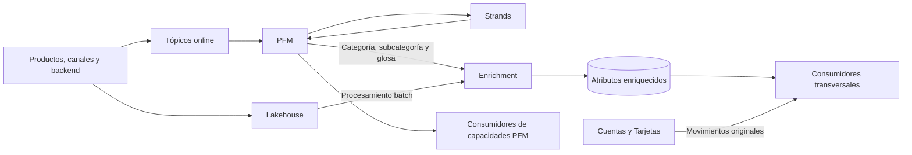
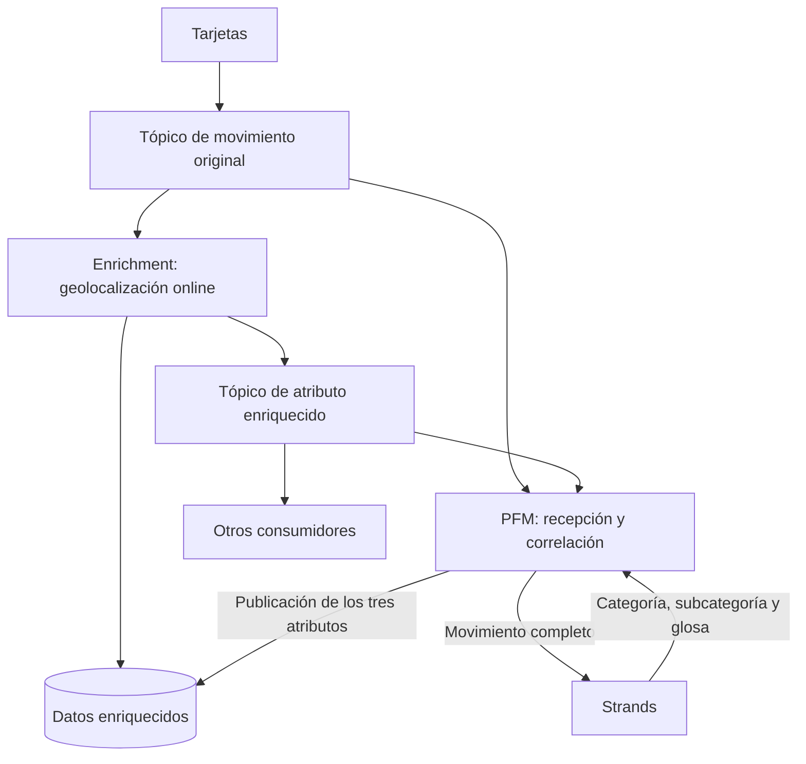
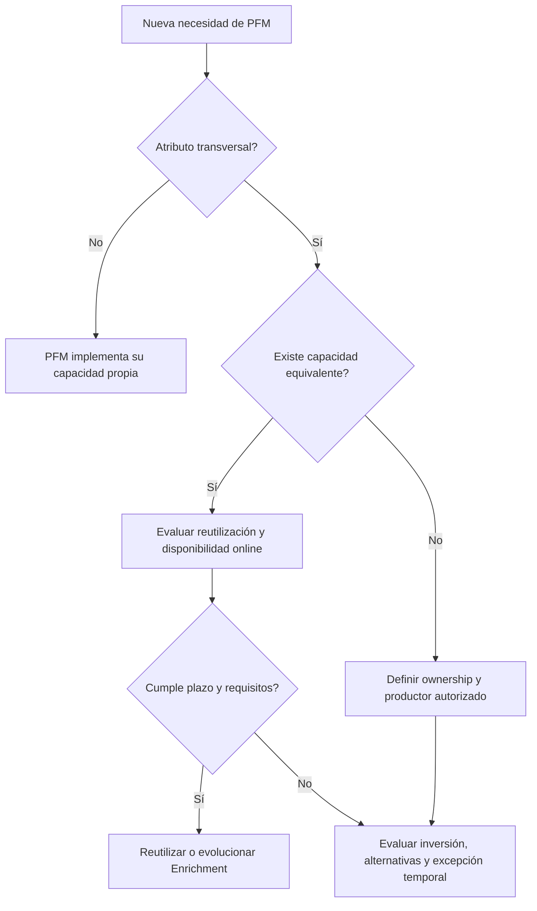

# Arquitectura de dominios: Enrichment y PFM

Fecha: 24 de noviembre de 2026  
Estado: propuesta para formalización en comité interno. El diseño conceptual de transición cuenta con aceptación verbal; la evolución online y los compromisos de ejecución están pendientes de validación.

## 1. Contexto

| Aspecto | Enrichment | PFM |
|---|---|---|
| Objetivo | Enriquecimiento transversal de movimientos | Finanzas personales |
| Procesamiento actual | Batch | Online |
| Fuentes | Lakehouse | Tópicos de productos, canales y backend |
| Resultados | 127 atributos de cuentas y 52 de tarjetas | Categoría, subcategoría, glosa enriquecida y funcionalidades propias |
| Ejecución | Lógicas internas del banco | Strands |
| Evolución | Procesamiento y entrega online | Consumo de nuevas fuentes |

PFM no persiste directamente los movimientos: Strands conserva 12 atributos originales para operar sus funcionalidades, incluyendo insights, dashboards, agregaciones, filtros, etiquetas y splits. Esta copia operativa no otorga autoridad para distribuir movimientos originales.

## 2. Principios

- Cuentas y Tarjetas son las fuentes autorizadas de movimientos originales.
- Enrichment gobierna y distribuye atributos enriquecidos transversales.
- PFM gobierna sus capacidades y resultados específicos de finanzas personales.
- Consumir o almacenar un dato no implica autoridad para distribuirlo.
- Múltiples dominios pueden consumir los mismos tópicos si sus responsabilidades son distintas.
- Separar productor técnico, propietario funcional y distribuidor autorizado.
- Priorizar reutilización antes de desarrollar enriquecimientos equivalentes.

## 3. Arquitectura de transición

PFM continúa operando con Strands sin tener que recuperar de Enrichment los tres atributos que ya obtiene. Publica esos atributos y sus actualizaciones de forma asíncrona hacia Enrichment. Enrichment los consolida con sus propios enriquecimientos batch.

Se restringirá el uso de APIs de PFM como fuente alternativa de movimientos originales. Identificar y migrar consumidores existentes antes de aplicar restricciones. La exposición de detalles dentro de funcionalidades propias de PFM debe respetar el alcance funcional autorizado y las políticas de gobierno y seguridad.

## 4. Riesgo de evolución

PFM prevé consumir más tópicos desde diciembre. Enrichment aspira a modernizar su procesamiento batch hacia online.

| Escenario | Evaluación |
|---|---|
| Consumo de los mismos tópicos | Válido |
| Generación de atributos distintos | Válido |
| Mejora de insights propios de PFM | Válido |
| Generación independiente del mismo atributo transversal | Evaluar duplicidad y autoridad |
| Contratar enriquecimientos equivalentes en Strands | Riesgo de inversión redundante y dependencia |
| Enrichment replica funcionalidades propias de PFM | Invasión de responsabilidades |

No existe evidencia suficiente para afirmar que las transformaciones técnicas sean idénticas ni para centralizar toda la ingesta. El alcance futuro de PFM está pendiente de confirmación.

## 5. TO-BE propuesto: enriquecimiento online reutilizable

Ejemplo ilustrativo: PFM necesita geolocalización de una compra con tarjeta para alimentar Strands. Enrichment ya genera este atributo en batch, pero no lo entrega online.

Priorizar la habilitación online en Enrichment antes de financiar una implementación equivalente en PFM o Strands.

Strands requiere recibir la información completa en una sola entrega. PFM debe correlacionar el movimiento original y el enriquecimiento antes de enviarlo. La publicación de los tres atributos se realizará mediante el contrato de integración de Enrichment, no mediante acceso directo a su base de datos.

Condiciones: identidad común del movimiento, latencia y disponibilidad acordadas, correlación de eventos, idempotencia, reintentos, manejo de eventos tardíos y recuperación ante fallos. Definir tratamiento de movimientos incompletos sin asumir que Strands permite actualizaciones parciales.

Beneficios esperados: evitar duplicación de lógica, reducir potenciales costos del proveedor, mantener conocimiento dentro del banco y acelerar la modernización de Enrichment. Trade-off: dependencia operativa de PFM para atributos obligatorios. No se han confirmado SLA, presupuesto ni fechas de entrega.

## 6. Criterio de decisión para nuevas necesidades

No obligar a Enrichment a implementar todas las necesidades de PFM. Si se requiere una excepción temporal, documentar justificación, responsable, plazo y condición de convergencia; evitar dos fuentes oficiales para el mismo atributo.

## 7. Acuerdos para formalizar

| ID | Acuerdo | Estado |
|---|---|---|
| AC-01 | Cuentas y Tarjetas distribuyen movimientos originales | Por formalizar |
| AC-02 | Enrichment gobierna y distribuye atributos enriquecidos transversales | Por formalizar |
| AC-03 | PFM publica categoría, subcategoría y glosa, incluyendo actualizaciones | Por formalizar |
| AC-04 | PFM conserva autonomía e integración con Strands | Por formalizar |
| AC-05 | Restringir APIs de PFM como fuente alternativa de movimientos | Por formalizar |
| AC-06 | Permitir consumo independiente de los mismos tópicos | Por formalizar |
| AC-07 | Evolucionar Enrichment hacia procesamiento y entrega online | Propuesto |
| AC-08 | Evaluar reutilización antes de implementar enriquecimientos equivalentes | Propuesto |
| AC-09 | Evaluar inversión en Enrichment antes de contratar desarrollos equivalentes en Strands | Propuesto |

## 8. Plan de ejecución

| ID | Acción | Responsable propuesto | Resultado |
|---|---|---|---|
| A01 | Formalizar diagramas y responsabilidades | Arquitectura | Diseño aprobado |
| A02 | Definir contrato de los tres atributos | PFM / Enrichment | Contrato de eventos |
| A03 | Resolver identidad común del movimiento | Arquitectura / Productos | Clave de correlación |
| A04 | Identificar consumidores de movimientos vía PFM | PFM | Plan de migración y restricción |
| A05 | Identificar alcance futuro de PFM | PFM | Capacidades y atributos requeridos |
| A06 | Contrastar necesidades nuevas con enriquecimientos existentes | PFM / Enrichment | Solapamientos confirmados |
| A07 | Evaluar implementación online priorizada | Enrichment | Esfuerzo, recursos y plazo |
| A08 | Definir latencia, disponibilidad y manejo de errores | PFM / Enrichment | Contrato operativo |
| A09 | Acordar inversión y ejecución | Líderes de dominios | Roadmap conjunto |

Asignar responsables nominales y fechas durante el comité; no se consideran compromisos confirmados todavía.

## 9. Reunión del miércoles

1. ¿Qué capacidades de negocio quiere habilitar PFM al consumir más tópicos?
2. ¿Qué atributos adicionales necesita generar o enviar a Strands?
3. ¿Cuáles ya genera Enrichment?
4. ¿En qué plazo y con qué latencia los necesita PFM?
5. ¿Podemos financiar conjuntamente la evolución online de Enrichment para evitar desarrollos equivalentes?

## 10. Mensaje ejecutivo

Mantener la independencia funcional de PFM y Enrichment, estableciendo responsabilidades claras sobre generación, gobierno y distribución de datos. Ambos pueden consumir las mismas fuentes transaccionales si atienden capacidades diferentes. Priorizar la implementación online de enriquecimientos transversales en Enrichment cuando exista una necesidad compartida y viabilidad operativa.

La evolución de PFM puede convertirse en un habilitador para financiar y acelerar la modernización de Enrichment, construyendo capacidades reutilizables para el banco.
